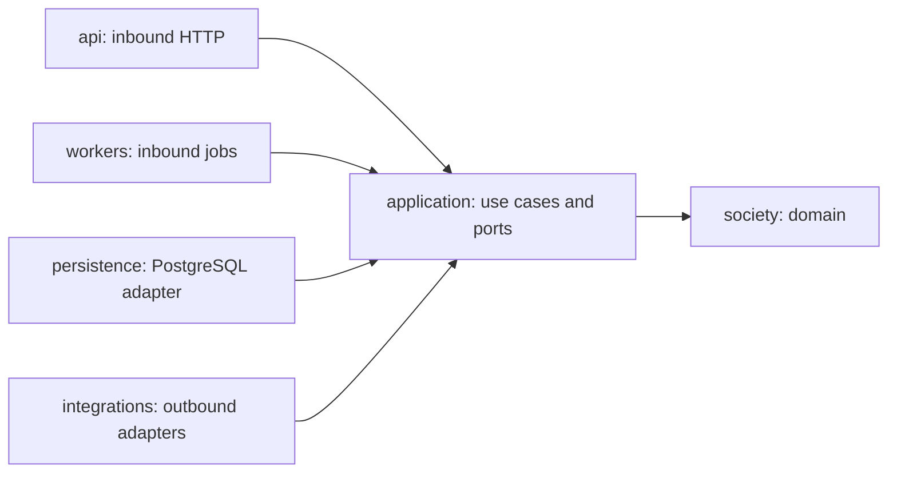

# Application architecture — Foundation v1

## Context and scope

Klados World is a Python application intended to host the existing AI society
without coupling its domain to legacy TEE or arena infrastructure. Foundation v1
establishes packaging, boundaries and verification. It implements only the wall-clock
port and adapter; it does not import society behavior or ship runnable services.
The runtime dependency set is empty. Python 3.12 is the initial validation baseline.

## Dependency direction

| Package | Responsibility | Permitted internal dependencies |
| --- | --- | --- |
| `society` | Rules, value objects, pure transitions | `society` only |
| `application` | Use cases, transactions orchestration, ports | `application`, `society` |
| `api` | Input validation, identity context, transport mapping | `api`, `application`, `society` |
| `workers` | Job delivery, retry/cancellation mapping | `workers`, `application`, `society` |
| `persistence` | PostgreSQL repositories and unit of work | `persistence`, `application`, `society` |
| `integrations` | Provider clients and wall-clock adapter | `integrations`, `application`, `society` |

Domain and application use standard-library dependencies only in this phase.
The root package is inert. A future composition root will construct and inject
adapters at process startup; its location and entry points require a follow-up ADR.
It must be the only layer allowed to assemble inbound and outbound adapters.
No composition root, web framework, task queue, ORM or database driver is selected.

The static architecture test resolves normal absolute and relative imports and
rejects forbidden layer imports. It is a guardrail, not a sandbox: dynamic imports
and runtime side effects still require code review. Third-party domain dependencies
require a reviewed architecture decision and an explicit test-policy change.

## Current explicit interface

`application.ports.Clock.now() -> datetime` returns timezone-aware UTC wall time.
`integrations.clock.SystemClock` implements it structurally. Tests can inject a
fixed clock. Wall time is not society time: only a future transactional use case
may advance persisted society ticks. Do not derive catch-up age from a clock read.

Other contracts will be extracted from characterized society operations, rather
than speculative generic CRUD or event interfaces. Do not treat reserved packages
as implemented systems or add adapters that return invented data.

## Persistence and consistency requirements for migration

PostgreSQL is the production target. Future repository contracts must keep SQL,
connections and driver row types out of the domain. The application owns a use-case
transaction boundary; adapters must not independently commit part of an operation.
Schema versioning, migration locking, rollback behavior, row locking and idempotency
need PostgreSQL integration tests before a persistence implementation is accepted.
Data/schema migration is separate from source migration and requires its own plan.

## Future API and worker boundary

An external agent is an untrusted caller. Before exposing any write API, review
identity binding, authorization per agent, bounded request schemas, replay and
idempotency handling, rate/budget limits, and sanitized errors. Keep private notes,
strategies, provider credentials and unpublished content out of public projections.
API and worker delivery must invoke the same application operations and preserve
existing action validation and publication gates. Authentication, endpoint versioning
and transport choices are deferred; no usable external-agent API is claimed here.

Worker orchestration must preserve pause, budget, retry and single-run guarantees.
Public output and private model context are different projections, not a single
serialized domain object. The migration plan defines behavior review gates.

## Ownership and evolution

See [platform-interface.md](platform-interface.md) for file ownership and application
check commands, [ADR index](adr/README.md) for decisions, and
[migration-plan.md](migration-plan.md) for scope and sequencing. No production,
VPS, existing TEE service or private-repository changes belong to Foundation v1.
